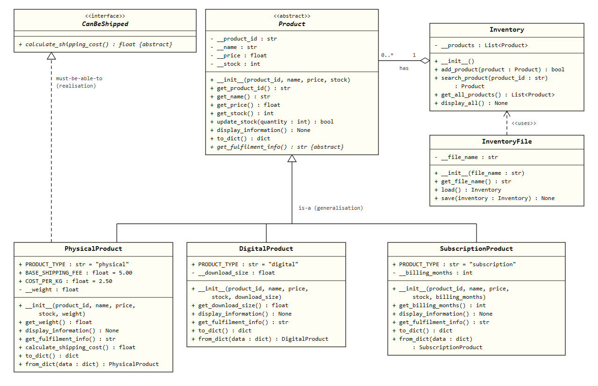
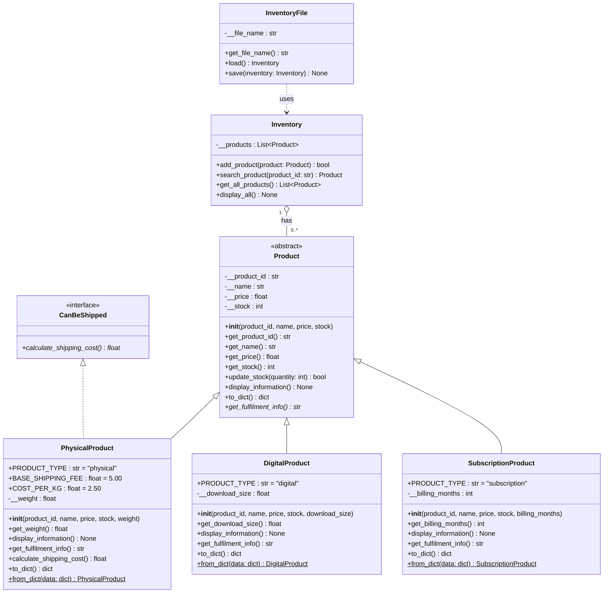

# Lab 7 - UML Class Diagram

Notation used:

- `<<abstract>>` above a class name = abstract class. Abstract methods are marked `{abstract}`.
- `<<interface>>` above a class name = interface-style abstract base class.
- `-` private, `+` public.
- Inheritance / generalisation: **solid line, hollow triangle** pointing at the parent (`___|>`).
- Interface realisation: **dashed line, hollow triangle** pointing at the interface (`- - -|>`).
- Aggregation: hollow diamond at the whole (`<>`).

(`UML.svg` / `UML.png` - same diagram. Mermaid version below renders in GitHub / VS Code.)

Relationships (read as sentences):

| From                | To            | Relationship                         | Sentence                                         |
|---------------------|---------------|--------------------------------------|--------------------------------------------------|
| PhysicalProduct     | Product       | Inheritance (solid, hollow triangle)  | A physical product **is-a** product              |
| DigitalProduct      | Product       | Inheritance (solid, hollow triangle)  | A digital product **is-a** product               |
| SubscriptionProduct | Product       | Inheritance (solid, hollow triangle)  | A subscription product **is-a** product          |
| PhysicalProduct     | CanBeShipped  | Realisation (dashed, hollow triangle) | A physical product **must-be-able-to** be shipped |
| Inventory           | Product       | Aggregation 1 to 0..*                 | An inventory **has** zero or more products       |
| InventoryFile       | Inventory     | Dependency (uses)                     | InventoryFile **loads/saves** an inventory       |

`DigitalProduct` does **not** realise `CanBeShipped`, since digital products are never shipped.

`product_types.py` (the `PRODUCT_TYPES` registry) and `main.py` are modules, not classes, so they are
not drawn. `InventoryFile` uses the registry to rebuild the right subclass from the saved `"type"`.

## Responsibilities (SRP)

| Class / module       | Responsibility                                                     |
|----------------------|--------------------------------------------------------------------|
| Product (abstract)   | Common product data, stock management, common display / to_dict     |
| PhysicalProduct      | Weight, physical fulfilment, shipping cost                          |
| DigitalProduct       | Download size, digital fulfilment                                   |
| SubscriptionProduct  | Billing period, subscription fulfilment (optional task)             |
| CanBeShipped         | Contract: anything shippable must calculate a shipping cost         |
| Inventory            | Stores, adds, searches and displays products (any type)             |
| InventoryFile        | Loads and saves inventory data (JSON) with type identifiers         |
| product_types.py     | Maps a type identifier to its class, menu label and extra prompt    |
| main.py              | Displays the menu, gets input, calls the classes                    |
